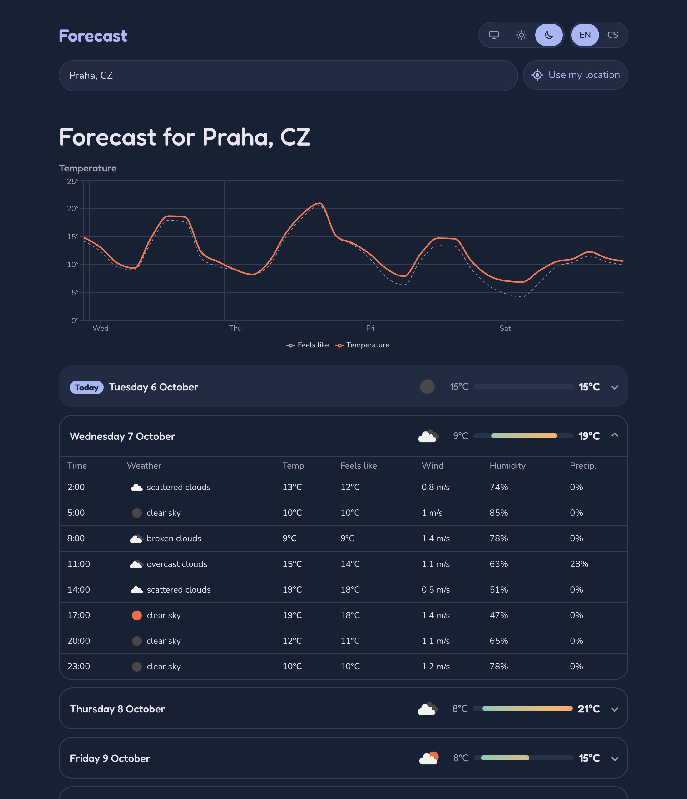

# Forecast

A five-day weather forecast using OpenWeatherMap. Search for a city or use your current location, then view temperatures on a chart and expand each day for a three-hour breakdown.

[Live demo](https://vkomolaev.github.io/forecast/)



The interface supports English and Czech, plus light and dark themes. The last location and settings are saved locally. Dates and numbers follow the browser locale; forecast times use the city's time zone.

## Run locally

Requires Node.js 24 and an [OpenWeatherMap API key](https://home.openweathermap.org/api_keys).

```sh
npm install
cp .env.example .env.local
```

Set `VITE_OWM_API_KEY` in `.env.local`, then run `npm run dev`.

```sh
npm test              # Unit tests
npm run lint         # ESLint
npm run typecheck    # TypeScript
npm run build        # Production build in dist/
npm run preview      # Preview the build
npm run cities       # Rebuild public/cities.json
```

Pushes to `main` deploy to GitHub Pages. The workflow reads the API key from the `OWM_API_KEY` repository secret. This is a client-only app, so the key is visible in the built JavaScript.

## Structure

Built with React, TypeScript, Redux Toolkit, redux-saga, Sass modules and Recharts.

- `src/api` — requests and response validation.
- `src/app` — Redux store, root saga and typed hooks.
- `src/features` — city search, forecast, geolocation and theme. Each folder keeps its components and related state together.
- `src/i18n` — English and Czech dictionaries and language switch.
- `src/lib` — formatting, storage and data checks.
- `src/styles` — shared styles and Sass mixins.
- `scripts/build-cities.ts` — prepares the OpenWeatherMap city list.

Reducers and forecast transforms are pure functions. Sagas handle loading, search debounce and request cancellation; React effects apply the theme and language to the page. Redux and Saga are included as bonus tasks from the assignment.

The city list contains about 196,000 entries, so it stays outside Redux. It is sorted by normalized name for binary prefix search. Search ignores diacritics and prefers exact matches, then the browser's region. The build script also adds Praha and Plzeň as aliases. In production, the list loads from jsDelivr with a local copy as fallback.

The API returns three-hour slots. The app groups them by local date and shows the first five days, including the remaining hours of today.

## Browsers

Targets current Chrome, Firefox and Edge on desktop and mobile. Safari has not been tested.
